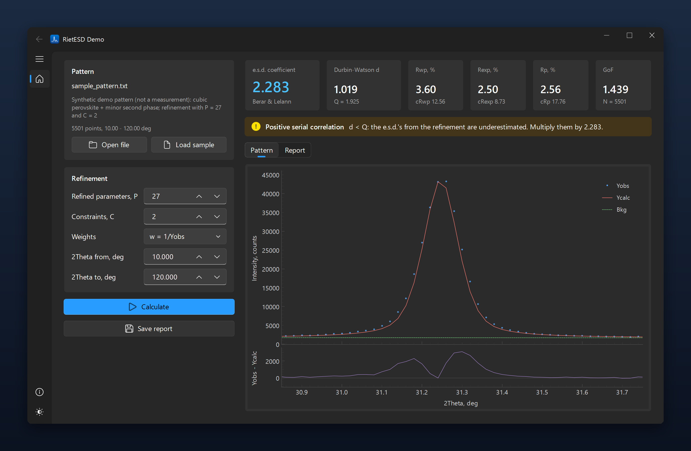
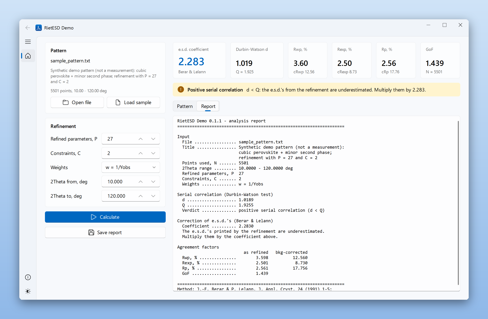
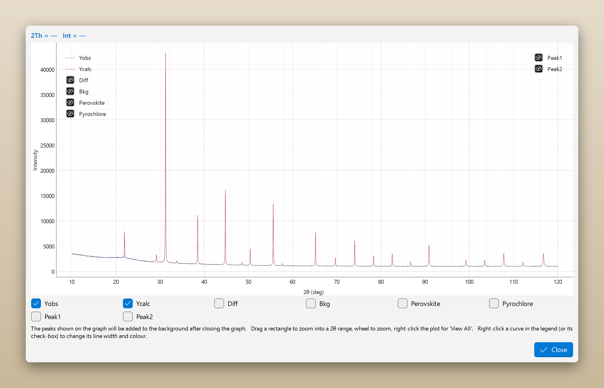
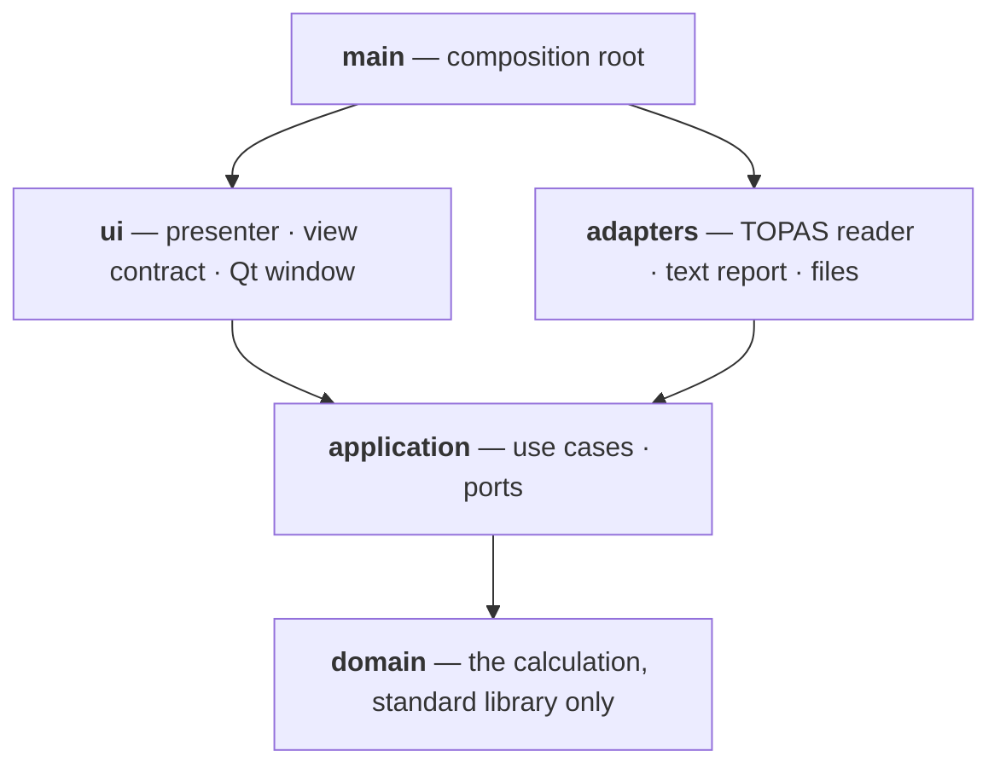

# RietESD Demo

**How far can you trust the error bars of a Rietveld refinement?**
RietESD Demo reads a refined powder-diffraction pattern, tests its residuals for serial
correlation and tells you by how much the estimated standard deviations have to be multiplied.

[](https://github.com/bolevin/rietesd-demo/actions/workflows/ci.yml)


This is a demonstration version of **RietESD**, a program by A. A. Levin with a Windows
edition by [@bolevin](https://github.com/bolevin). It is small on purpose — one input format, one screen — and is meant to
show two things: what the method does, and how the software around it is built.

## The problem it solves

A Rietveld refinement fits a calculated diffraction pattern to a measured one by least
squares and prints an estimated standard deviation (e.s.d.) for every refined parameter.
Least squares assumes that the misfit at one point says nothing about the misfit at the
next. In a diffraction pattern that is rarely true: a peak that is slightly too narrow or
slightly shifted leaves a whole run of points that err in the same direction.



*One reflection of the sample pattern. The difference curve below stays positive across the
whole peak — these points are not independent observations.*

The consequence is that the printed e.s.d.'s are too small, often by a factor of two or
more. The program measures the effect and corrects for it:

| Quantity | Meaning | Reference |
|---|---|---|
| Durbin–Watson *d*, critical value *Q* | Are the residuals serially correlated? (*d* < *Q*: yes) | Hill & Flack, *J. Appl. Cryst.* **20** (1987) 356 |
| e.s.d. coefficient | Multiply the e.s.d.'s of the refinement by this value | Bérar & Lelann, *J. Appl. Cryst.* **24** (1991) 1 |
| Rwp, Rexp, Rp, GoF | Agreement factors, as refined and background-corrected (cRwp, cRexp, cRp) | — |

## Try it

```powershell
git clone https://github.com/bolevin/rietesd-demo
cd rietesd-demo
py -3.11 -m venv .venv
.venv\Scripts\pip install -e .
.venv\Scripts\rietesd-demo
```

Press **Load sample**, enter P = 27 and C = 2 (the number of refined parameters and of
constraints), press **Calculate**. You should see:

| e.s.d. coefficient | *d* | *Q* | Rwp | Rexp | Rp | GoF |
|---|---|---|---|---|---|---|
| 2.283 | 1.019 | 1.925 | 3.60 % | 2.50 % | 2.56 % | 1.439 |

The sample is synthetic — a simulated scan of a cubic perovskite, generated by
[`tools/make_sample.py`](tools/make_sample.py) with a fixed seed. No measured data is part
of this repository. Your own patterns load through **Open file** if they are in the
comma-separated layout TOPAS v.5 exports (`x, Yobs, Ycalc, Diff, …, Bkg`).

| Dark theme | Text report |
|---|---|
|  |  |

## Demo and full program

| | Demo (this repository) | RietESD 15.06 |
|---|:---:|:---:|
| Durbin–Watson test, Bérar coefficient | ✓ | ✓ |
| Rwp, Rexp, Rp, GoF, background-corrected variants | ✓ | ✓ |
| Further families of factors (b, CSD, cCSD) | | ✓ |
| Input: TOPAS v.5 | ✓ | ✓ |
| Input: RietToTens | | ✓ |
| Peaks folded into the background, by click on the plot | | ✓ |
| Bragg factors per phase | | ✓ |
| Angular corrections (zero shift, displacement, three conventions) | | ✓ |
| Intensity and weight modeling | | ✓ |
| Batch mode over a series of files, summary table for Word | | ✓ |
| Listing identical to the QuickBASIC original | | ✓ |

The full program on the same synthetic pattern:




## How it is built



- **Ports and adapters.** The calculation is a set of pure functions over immutable values.
  It reads no file and knows no window. Use cases declare what they need as interfaces;
  files and Qt implement them at the edge.
- **Model–View–Presenter with a passive view.** The presenter is plain Python and decides
  everything; the window only shows what it is handed. The whole interaction — including
  file dialogs and every error path — is tested without a display.
- **Architecture rules are tests.** "The calculation imports nothing but the standard
  library" and "the presenter never touches Qt" are import contracts checked on every run.
- **Typed and linted.** `mypy --strict`, `ruff` with a broad rule set, one formatting style.

The reasoning is written down: [`docs/architecture.md`](docs/architecture.md) follows the
arc42 template, and each decision has its own record in [`docs/adr/`](docs/adr/).

## How the numbers are checked

| Layer | What it shows |
|---|---|
| **Golden master** | All reported values agree with the full RietESD program on the sample pattern, for both weighting schemes. The two programs share no code. Measured agreement: about 10⁻⁸. |
| **Hand-worked examples** | Every sum on a four-point pattern; the Bérar algorithm traced on paper for a three-point run. |
| **Property-based tests** | For generated patterns: 0 ≤ *d* ≤ 4, nothing is negative, and counting twice as long changes neither *d* nor the R-factors. |
| **Mutation check** | Eighteen deliberate mistakes are planted one at a time; each must turn the suite red. A test that cannot fail is worse than no test. |

```powershell
.venv\Scripts\pip install -e .[dev]
.venv\Scripts\python -m pytest --cov        # 92 tests
.venv\Scripts\python -m mypy                # strict
.venv\Scripts\python -m ruff check .
.venv\Scripts\lint-imports                  # the architecture contracts
.venv\Scripts\python tools\mutation_check.py
```

The mutation check earned its place while this repository was being written. It showed that
the test "numbers use a point whatever the system locale" passed with the fix removed: the
test had switched to Swiss German, which uses a point as well. The test now uses German.

## Where it comes from

RietESD began as a QuickBASIC program of about 5,800 lines: console prompts, `GOTO`,
single-precision arithmetic. The full Windows edition was developed from it in fifteen
specification-driven steps:

- **A faithful port first.** The Python core reproduces the listing of the original digit
  for digit, emulating single precision operation by operation and QuickBASIC's number
  formatting character by character. Only then did features follow.
- **Specifications from the scientist.** Each step started from a written specification by
  the author of the method and ended with a regression block that stays in the suite, so
  that step fifteen still proves what step one promised.
- **Pixels, not properties.** Visual changes were accepted on rendered images of the real
  window — a headless test reads a label's text and never sees that it is clipped.
- **Tests of the tests.** New assertions had to be shown failing on broken code before
  they counted.
- **Human direction, machine labour.** Requirements, physics and acceptance came from the
  authors; implementation was done with an AI coding agent (Claude Code) working under
  those rules.

The demo was then written from scratch — not cut down from the full program — to show the
same method in a code base organised for reading.

## Repository layout

```
src/rietesd_demo/
    domain/         the calculation
    application/    use cases and ports
    adapters/       TOPAS reader, text report, file store
    ui/             presenter, view contract, Qt window, plot
    data/           synthetic sample pattern, icon
    main.py         composition root, command line
tests/              mirrors the package; golden/ holds the reference values
tools/              sample, icon, reference values, screenshots, mutation check
docs/               architecture.md (arc42), adr/, img/
packaging/          PyInstaller spec for the one-file executable
```

## Building the executable

```powershell
.venv\Scripts\pip install -e .[build]
.venv\Scripts\pyinstaller packaging\rietesd-demo.spec
dist\rietesd-demo.exe --selftest
```

The executable is not code-signed, so Windows SmartScreen shows a warning the first time it
is started ("More info" → "Run anyway").

## Citing

If the method contributed to a publication, please cite

> A. A. Levin, *Program RietESD for correction of estimated standard deviations obtained in
> Rietveld-refinement programs* (2022), preprint.
> DOI: [10.13140/RG.2.2.27758.69444](https://doi.org/10.13140/RG.2.2.27758.69444)

Machine-readable metadata is in [`CITATION.cff`](CITATION.cff).

## Authors and licence

A. A. Levin — method, original program. [@bolevin](https://github.com/bolevin) — Windows edition, this demo.

Free software under the **GNU General Public License, version 3 or later**; see
[`LICENSE`](LICENSE). The interface is built on QFluentWidgets, which is itself GPL-3.0 —
[`THIRD-PARTY-NOTICES.md`](THIRD-PARTY-NOTICES.md) lists every component.
