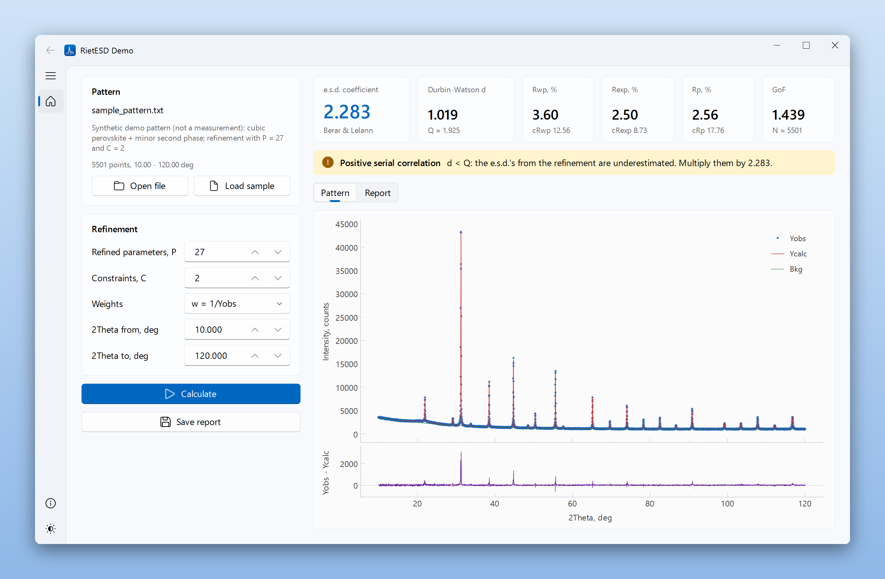
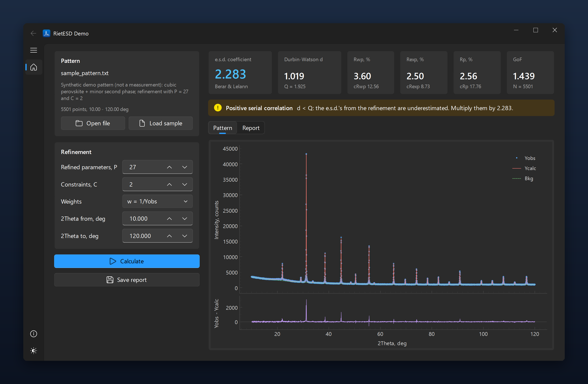
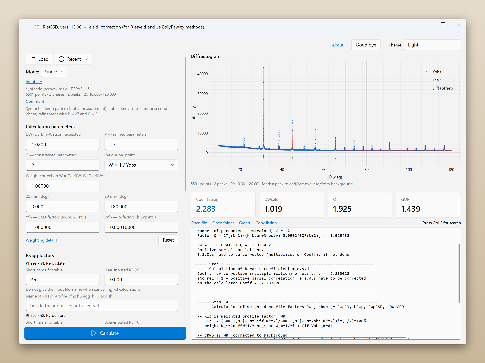
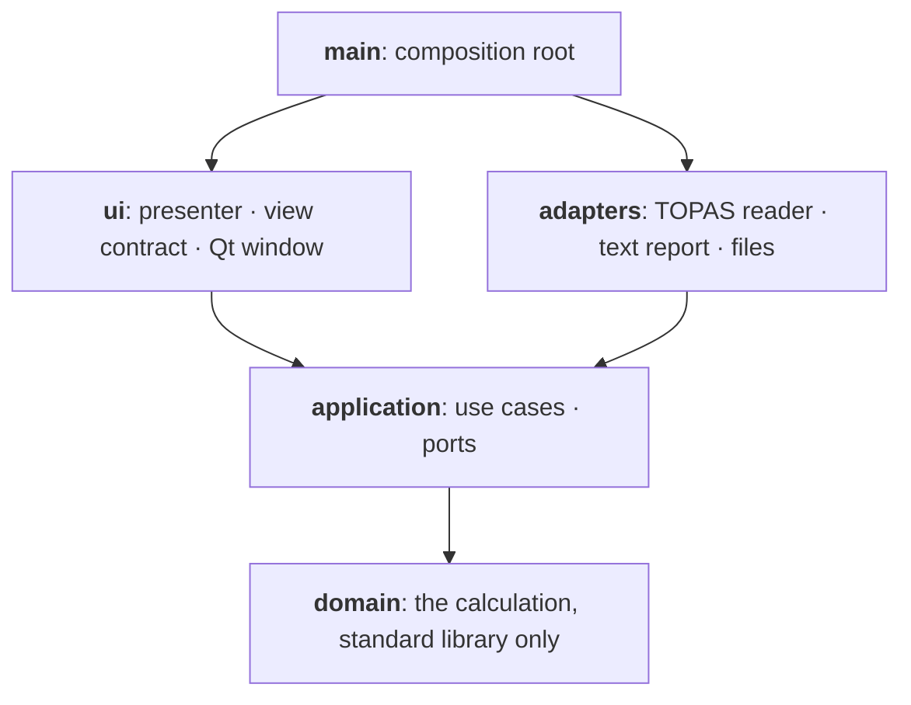

# RietESD Demo

**How far can you trust the error bars of a Rietveld refinement?**
RietESD Demo reads a refined powder diffraction pattern, tests its residuals for serial
correlation and tells you by how much the estimated standard deviations have to be multiplied.

[](https://github.com/bolevin/rietesd-demo/actions/workflows/ci.yml)




This is a demonstration version of **RietESD**, a program by A. A. Levin with a Windows
edition by [@bolevin](https://github.com/bolevin). It covers one input format and one screen.
It is here to show what the method does and how I think scientific software should be built.

## The problem it solves

A Rietveld refinement fits a calculated diffraction pattern to a measured one by least
squares and prints an estimated standard deviation (e.s.d.) for every refined parameter.
Least squares assumes that the misfit at one point says nothing about the misfit at the
next. In a diffraction pattern that is rarely true. A peak that is a little too narrow or a
little shifted leaves a whole run of points that err in the same direction.


*One reflection of the sample pattern. The difference curve below stays positive across the
whole peak, so these points are not independent observations.*

As a result the printed e.s.d.'s are too small, often by a factor of two or more. The
program measures the effect and corrects for it:

| Quantity | Meaning | Reference |
|---|---|---|
| Durbin-Watson *d*, critical value *Q* | Are the residuals serially correlated? (*d* < *Q*: yes) | Hill & Flack, *J. Appl. Cryst.* **20** (1987) 356 |
| e.s.d. coefficient | Multiply the e.s.d.'s of the refinement by this value | Bérar & Lelann, *J. Appl. Cryst.* **24** (1991) 1 |
| Rwp, Rexp, Rp, GoF | Agreement factors, as refined and background-corrected (cRwp, cRexp, cRp) | |

## Try it

```powershell
git clone https://github.com/bolevin/rietesd-demo
cd rietesd-demo
py -3.11 -m venv .venv
.venv\Scripts\pip install -e .
.venv\Scripts\rietesd-demo
```

Press **Load sample**, enter P = 27 and C = 2 (the number of refined parameters and of
constraints) and press **Calculate**. You should see:

| e.s.d. coefficient | *d* | *Q* | Rwp | Rexp | Rp | GoF |
|---|---|---|---|---|---|---|
| 2.283 | 1.019 | 1.925 | 3.60 % | 2.50 % | 2.56 % | 1.439 |

The sample is synthetic: a simulated scan of a cubic perovskite, generated by
[`tools/make_sample.py`](tools/make_sample.py) with a fixed seed. There is no measured data in
this repository. Your own patterns load through **Open file** if they are in the
comma-separated layout that TOPAS v.5 exports (`x, Yobs, Ycalc, Diff, …, Bkg`).

| Dark theme | Text report |
|---|---|
|  |  |

## Demo and full program

| | Demo (this repository) | RietESD 15.06 |
|---|:---:|:---:|
| Durbin-Watson test, Bérar coefficient | ✓ | ✓ |
| Rwp, Rexp, Rp, GoF, background-corrected variants | ✓ | ✓ |
| Further families of factors (b, CSD, cCSD) | | ✓ |
| Input: TOPAS v.5 | ✓ | ✓ |
| Input: RietToTens | | ✓ |
| Peaks folded into the background, by click on the plot | | ✓ |
| Bragg factors per phase | | ✓ |
| Angular corrections (zero shift, displacement, three conventions) | | ✓ |
| Intensity and weight modeling | | ✓ |
| Batch mode over a series of files, summary table for Word | | ✓ |
| Listing identical to the QuickBASIC original | | ✓ |

The full program on the same synthetic pattern:




## How it is built



The calculation is plain Python: pure functions over immutable values, with no files and no
window. The use cases say what they need through small interfaces, and the file and Qt code
at the edge provides it. The window follows Model-View-Presenter with a passive view. The
presenter makes every decision, so the whole interaction can be tested without a display,
file dialogs and error paths included.

Two rules run as import contracts with every test run: the calculation imports only the
standard library, and the presenter never imports Qt. On top of that come `mypy --strict`,
`ruff` with a broad rule set and one formatting style.

The reasons behind these choices are in [`docs/architecture.md`](docs/architecture.md),
written along arc42, and in one record per decision in [`docs/adr/`](docs/adr/).

## How the numbers are checked

| Layer | What it shows |
|---|---|
| **Golden master** | The full RietESD program, run on the sample pattern, gives the reference values for both weighting schemes. The two programs share no code. They agree to about 10⁻⁸. |
| **Hand-worked examples** | Every sum on a four-point pattern, and the Bérar algorithm traced on paper for a three-point run. |
| **Property-based tests** | For generated patterns: 0 ≤ *d* ≤ 4, nothing is negative, and counting twice as long changes neither *d* nor the R-factors. |
| **Mutation check** | Eighteen deliberate mistakes are planted one at a time, and each of them has to turn the suite red. |

```powershell
.venv\Scripts\pip install -e .[dev]
.venv\Scripts\python -m pytest --cov        # 92 tests
.venv\Scripts\python -m mypy                # strict
.venv\Scripts\python -m ruff check .
.venv\Scripts\lint-imports                  # the architecture contracts
.venv\Scripts\python tools\mutation_check.py
```

The mutation check paid off while I was writing this repository. It showed that the test
"numbers use a point whatever the system locale" still passed with the fix removed. The test
had switched to Swiss German, which uses a point as well. Now it switches to German.

## Where it comes from

RietESD began as a QuickBASIC console program of about 5,800 lines, with prompts, `GOTO` and
single-precision arithmetic. I took it to a full Windows application in fifteen planned steps.

- First came a faithful port. The Python core reproduces the listing of the original digit
  for digit, down to single precision and the way QuickBASIC formats its numbers. New features
  came only after that.
- Each step started from a written specification by the author of the method and ended with
  a regression block that stays in the suite. Step fifteen still proves what step one promised.
- I accepted visual changes on rendered images of the real window. A headless test can read
  the text of a label and still miss that the label is cut off.
- A new check counted only after I had seen it fail on broken code.

The physics and the requirements came from the scientist. I owned the rest: the plan, the
acceptance rules, the architecture and the releases. The code was written by an AI coding
agent (Claude Code) working to those rules, and no step was accepted before I had reviewed it.

The demo was written afterwards from scratch, not cut down from the full program, so that the
same method sits in a code base that is easy to read.

## Repository layout

```
src/rietesd_demo/
    domain/         the calculation
    application/    use cases and ports
    adapters/       TOPAS reader, text report, file store
    ui/             presenter, view contract, Qt window, plot
    data/           synthetic sample pattern, icon
    main.py         composition root, command line
tests/              mirrors the package; golden/ holds the reference values
tools/              sample, icon, reference values, screenshots, mutation check
docs/               architecture.md (arc42), adr/, img/
packaging/          PyInstaller spec for the one-file executable
```

## Building the executable

```powershell
.venv\Scripts\pip install -e .[build]
.venv\Scripts\pyinstaller packaging\rietesd-demo.spec
dist\rietesd-demo.exe --selftest
```

The executable is not code-signed, so Windows SmartScreen shows a warning the first time it
is started ("More info", then "Run anyway").

## Citing

If the method contributed to a publication, please cite

> A. A. Levin, *Program RietESD for correction of estimated standard deviations obtained in
> Rietveld-refinement programs* (2022), preprint.
> DOI: [10.13140/RG.2.2.27758.69444](https://doi.org/10.13140/RG.2.2.27758.69444)

Machine-readable metadata is in [`CITATION.cff`](CITATION.cff).

## Authors and licence

A. A. Levin: the method and the original program. [@bolevin](https://github.com/bolevin): the
Windows edition and this demo.

Free software under the **GNU General Public License, version 3 or later**, see
[`LICENSE`](LICENSE). The interface is built on QFluentWidgets, which is GPL-3.0 as well.
[`THIRD-PARTY-NOTICES.md`](THIRD-PARTY-NOTICES.md) lists every component.
