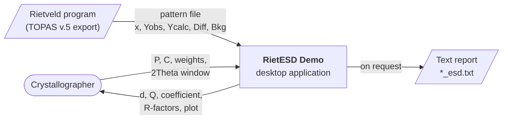
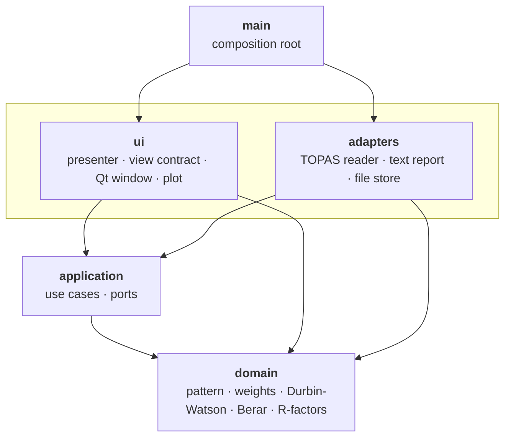
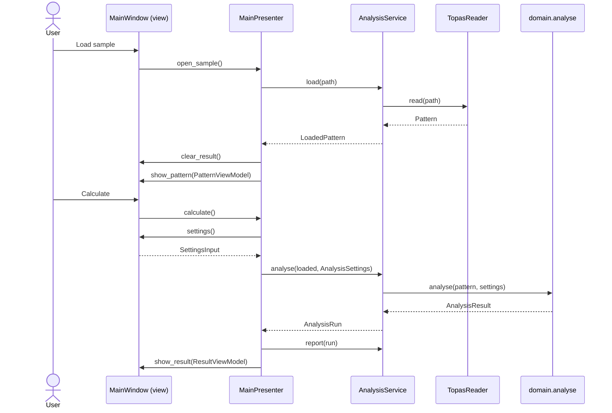
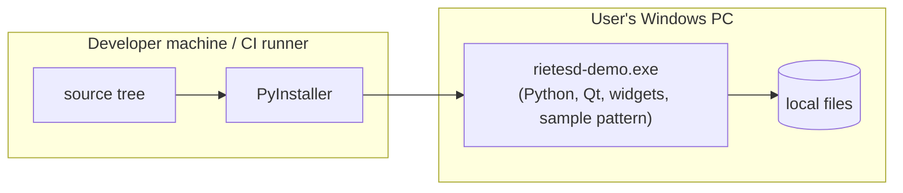

# RietESD Demo — architecture (arc42)

This document follows the [arc42](https://arc42.org) template, all twelve sections, kept lean.
Decisions are recorded one per file in [`adr/`](adr/). Where a rule or a quality goal is
enforced by a test, the test is named — a statement here that no test holds is marked as such.

| | |
|---|---|
| Version described | 0.1.0 |
| Audience | developers, reviewers, anyone judging how the program is built |

---

## 1. Introduction and goals

### 1.1 What the program does

A Rietveld refinement fits a calculated powder-diffraction pattern to a measured one and
prints estimated standard deviations (e.s.d.'s) for the refined parameters. Least squares
assumes that the residuals of neighbouring points are independent. They rarely are: a
slightly misfitted peak leaves a run of points that all err in the same direction, and the
printed e.s.d.'s come out too small.

RietESD Demo reads a refined pattern and reports

- the **Durbin–Watson statistic** *d* and its critical value *Q* (Hill & Flack, 1987), which
  say whether the residuals are serially correlated;
- the **coefficient** by which the e.s.d.'s have to be multiplied (Bérar & Lelann, 1991);
- the **agreement factors** Rwp, Rexp, Rp and GoF, as refined and background-corrected.

It is a demonstration version of the RietESD program by A. A. Levin, with a
Windows edition by bolevin. The full program is a separate code base; the demo shares no code with it
and is checked against it (section 8.1).

### 1.2 Quality goals, in priority order

| # | Goal | What it means here |
|---|---|---|
| 1 | **Correct numbers** | Every reported value agrees with the full program to the precision that program prints. |
| 2 | **Changeable without fear** | A new input format, report layout or weighting scheme touches one module; the calculation is never edited to serve the window. |
| 3 | **Testable without a screen** | Everything except the pixels is exercised by tests that need no display and no file dialog. |
| 4 | **Honest failure** | A malformed file or an impossible setting produces a message that names the cause; no stale result stays on screen. |

Section 10 turns each goal into scenarios and names the tests that hold them.

### 1.3 Stakeholders

| Who | What they need from this document |
|---|---|
| Crystallographer using the program | Confidence in the numbers: sections 1.1, 8.1, 11 |
| Developer extending it | Where things go and which rules are enforced: sections 5, 8, 9 |
| Reviewer of the code base | The decisions and their reasons: sections 4, 9, `adr/` |

## 2. Constraints

| Constraint | Consequence |
|---|---|
| Windows 10/11 desktop, no installer | One-file `.exe` built with PyInstaller; no services, no registry use |
| Python ≥ 3.11 | `slots` dataclasses, `itertools.pairwise`, `X | None` types |
| GUI toolkit is PySide6 with QFluentWidgets | QFluentWidgets is GPL-3.0, so the program is GPL-3.0-or-later ([ADR 0003](adr/0003-fluent-widgets-and-gpl.md)) |
| Only synthetic data may ship | The bundled pattern is generated by `tools/make_sample.py` ([ADR 0006](adr/0006-synthetic-sample-data.md)) |
| Results must match the reference program | The reference algorithm is followed literally, including its quirks ([ADR 0005](adr/0005-follow-the-reference-algorithm.md)) |

## 3. Context and scope

**Business context.** One actor, one input, one optional output. The user refines a
structure elsewhere, exports the pattern, and brings to this program the two numbers only
they know: how many parameters were refined (P) and how many constraints tied them (C).

**Technical context.** The only interfaces are the local file system (a comma-separated
text file in, a UTF-8 text file out) and the screen. There is no network access, no
database and no persisted setting.

**Out of scope.** Batch processing, Bragg factors, angular corrections, intensity
modeling, the b- and CSD-families of agreement factors and the RietToTens input format
belong to the full program.

## 4. Solution strategy

| Goal | Approach |
|---|---|
| Correct numbers | A pure calculation with no I/O, pinned by a golden-master test against the full program, hand-worked examples and property-based tests ([ADR 0004](adr/0004-double-precision-golden-master.md)) |
| Changeable | Ports and adapters: the calculation and the use cases define interfaces; files and windows implement them ([ADR 0001](adr/0001-ports-and-adapters.md)) |
| Testable without a screen | Model–View–Presenter with a passive view: the presenter is plain Python and is tested against a fake view ([ADR 0002](adr/0002-mvp-passive-view.md)) |
| Rules that stay true | The dependency rule is a test, not a convention ([ADR 0007](adr/0007-architecture-rules-as-tests.md)) |
| Trustworthy tests | Every guard is shown to fail on deliberately broken code (`tools/mutation_check.py`) |

## 5. Building block view

### 5.1 Level 1

| Block | Responsibility | Depends on |
|---|---|---|
| `domain` | The calculation: immutable values and pure functions | standard library only |
| `application` | The three use cases (load, analyse, export) and the ports they need | `domain` |
| `adapters` | The ports implemented with files and text | `application`, `domain` |
| `ui` | Presenter, view contract, the Qt window | `application`, `domain` |
| `main` | Builds the concrete objects and wires them | everything |

### 5.2 Level 2: `domain`

| Module | Contents |
|---|---|
| `pattern` | `Pattern`: four parallel columns and a title. Valid by construction — equal lengths, finite values, increasing 2Theta, no negative counts. `window(low, high)` returns the part to analyse. |
| `weighting` | `WeightScheme`: the weight and the standard uncertainty of a point as a function of its intensity. A strategy expressed as an enum. |
| `statistics` | `durbin_watson`, `critical_value`, `classify` → `Correlation` |
| `berar` | `esd_coefficient`: the Bérar–Lelann re-estimate of the sum of squares |
| `agreement` | `agreement_factors` → `AgreementFactors` |
| `analysis` | `AnalysisSettings`, `AnalysisResult`, and `analyse(pattern, settings)` — the whole calculation as one function |
| `errors` | `DomainError` → `InvalidPatternError`, `InsufficientDataError` |

### 5.3 Level 2: `ui`

| Module | Contents | Imports Qt |
|---|---|---|
| `view` | `MainView` (a `Protocol`) and the view models: text already formatted, plain tuples of numbers | no |
| `presenter` | `MainPresenter`: turns intents into use-case calls and results into view models; owns the error messages | no |
| `main_window` | `MainWindow`: the one implementation of `MainView`; shows what it is given, forwards clicks | yes |
| `plot` | `PlotPanel`: pattern above, difference curve below; re-colours itself on a theme switch | yes |

### 5.4 Dependency rules

Three contracts in `pyproject.toml` (`[tool.importlinter]`), run by
`tests/architecture/test_layers.py` and as a CI step of their own:

1. **Dependencies point inwards**: `main` → `ui` | `adapters` → `application` → `domain`;
   `ui` and `adapters` do not know each other.
2. **The calculation depends on the standard library only**: `domain` and `application`
   may not import PySide6, QFluentWidgets, pyqtgraph or numpy.
3. **The presenter is free of Qt**: `ui.presenter` and `ui.view` may not import PySide6,
   QFluentWidgets or pyqtgraph.

## 6. Runtime view

### 6.1 Load a pattern and calculate

### 6.2 When something is wrong

Errors are values of three known kinds — `OSError` (the file system), `PatternFormatError`
(the file is not a pattern), `DomainError` (the pattern or the settings cannot be analysed).
Each carries a sentence written for the user. The presenter catches exactly these, calls
`clear_result()` so that no number from an earlier run stays visible, and shows the message.
A file that fails to load leaves the previously loaded pattern in place.

### 6.3 Inside `analyse`

1. Cut the pattern to the 2Theta window (both ends included).
2. Residuals `Yobs − Ycalc`; uncertainties `σ = 1/√w` from the weighting scheme.
3. Durbin–Watson *d* from the weighted residuals; *Q* from N, P, C; verdict.
4. Bérar–Lelann coefficient from residuals and uncertainties.
5. Agreement factors with N − P + C degrees of freedom.

No step reads or writes anything; the same input always gives the same output.

## 7. Deployment view

Two ways to run it: from source (`pip install -e .` then `rietesd-demo`), or as a single
executable built from `packaging/rietesd-demo.spec`. The executable carries the interpreter,
Qt, the widget library and the sample pattern; it needs no installation and writes nothing
except the reports the user saves. `rietesd-demo --selftest` verifies a build without
opening a window. The release workflow builds the executable when a version tag is pushed.

## 8. Crosscutting concepts

### 8.1 Verification of the numbers

| Layer | What it shows | Where |
|---|---|---|
| Golden master | All eleven reported values equal those of the full RietESD program on the bundled pattern, for both weighting schemes, to 5 × 10⁻⁷ (the reference is single precision) | `tests/domain/test_golden.py`, recorded by `tools/make_golden.py` |
| Hand-worked examples | Every sum on four points; the Bérar algorithm traced on paper for a three-point run | `tests/domain/test_agreement.py`, `test_berar.py`, `test_statistics.py` |
| Properties | For generated patterns: 0 ≤ *d* ≤ 4; nothing is negative; multiplying all intensities by a constant leaves *d* and the R-factors unchanged | `tests/domain/test_properties.py` |
| Mutation check | Eighteen deliberate mistakes; each must turn the suite red | `tools/mutation_check.py` |

The golden master is independent evidence: the two programs share no code, and the reference
values are committed as JSON, so the test needs nothing but this repository.

### 8.2 Errors

Exceptions are raised where the fact is known and caught in one place, the presenter. The
message is composed at the point of failure ("Line 3: 3 values, expected 4"), never
reconstructed later. Programming errors are not caught.

### 8.3 Numbers in and out

Input fields use the C locale: a point is the decimal separator whatever Windows is set to
(`tests/ui/test_main_window.py`, with a German system locale). Reports are plain text with
fixed decimals and CRLF line ends. Internally everything is `float`; rounding happens only
when text is produced.

### 8.4 Presentation

View models carry finished strings. Formatting therefore lives in the presenter and the
report adapter and is tested there; the window has no number formatting of its own.
Theming: the widget library follows a light or dark theme; the plot keeps its own two
palettes and rebuilds its curves on a switch, because the plotting library fixes colours
when an item is created.

### 8.5 Testing

Tests mirror the package layout. The presenter is tested against a `FakeView` that records
calls and answers dialogs from a script; the Qt window is driven through its widgets on the
offscreen platform. Visual checks are done on rendered images (`tools/make_screenshots.py`),
because an offscreen test cannot see a wrong colour or a clipped label.

## 9. Architecture decisions

| ADR | Decision |
|---|---|
| [0001](adr/0001-ports-and-adapters.md) | Ports and adapters around a pure domain |
| [0002](adr/0002-mvp-passive-view.md) | Model–View–Presenter with a passive view |
| [0003](adr/0003-fluent-widgets-and-gpl.md) | QFluentWidgets for the interface; GPL-3.0-or-later as a consequence |
| [0004](adr/0004-double-precision-golden-master.md) | Double precision, verified by a golden master against the full program |
| [0005](adr/0005-follow-the-reference-algorithm.md) | Follow the reference algorithm literally |
| [0006](adr/0006-synthetic-sample-data.md) | Ship synthetic sample data only |
| [0007](adr/0007-architecture-rules-as-tests.md) | Architecture rules are tests |

## 10. Quality requirements

Each scenario is held by the test named beside it.

| Goal | Scenario | Held by |
|---|---|---|
| Correct numbers | The bundled pattern with P = 27, C = 2 gives the coefficient and factors of the full program, for both weighting schemes | `test_golden.py::test_demo_reproduces_the_full_program` |
| Correct numbers | The reference values belong to the pattern that ships | `test_golden.py::test_reference_belongs_to_the_bundled_pattern` |
| Changeable | A use case runs with every port replaced by an in-memory fake | `tests/application/test_service.py` |
| Changeable | A module of the calculation that imports numpy or Qt fails the build | `tests/architecture/test_layers.py` |
| Testable without a screen | The complete load–calculate–save flow, including dialogs, runs without Qt | `tests/ui/test_presenter.py` |
| Honest failure | Seven kinds of malformed file each give a message naming the cause and the line | `test_topas.py::test_malformed_files_are_refused_with_a_reason` |
| Honest failure | After a failed calculation no earlier result is shown and saving is disabled | `test_presenter.py::test_bad_settings_clear_the_old_result`, `test_main_window.py::test_an_error_clears_the_result_and_disables_saving` |
| Honest failure | `nan` in a data row is refused, not summed | `test_topas.py::test_not_a_number_never_becomes_data` |

## 11. Risks and technical debt

| Item | Status |
|---|---|
| **One input format.** Only the TOPAS v.5 export is read. | Accepted for a demo. A second format is one new adapter implementing `PatternReader`. |
| **2Theta window edge.** The demo keeps the points with `min ≤ 2Theta ≤ max`. The full program follows its QBASIC original and may keep one extra point below the lower limit. With a restricted window the two can differ by one point; over the whole pattern they agree. | Documented; the golden master covers the whole pattern only. |
| **Last point of the scan.** The reference algorithm adds a point to the corrected sum when its successor arrives, so the final point enters the plain sum only. The effect is of order 1/N. | Kept deliberately ([ADR 0005](adr/0005-follow-the-reference-algorithm.md)); pinned by `test_berar.py`. |
| **Points with zero counts.** The demo weighs a point with Yobs = 0 as one count. The full program treats this case differently, so patterns that contain zero-count points lie outside what the golden master covers; the bundled pattern has none. | Open; behaviour pinned by `test_statistics.py::test_zero_counts_weigh_as_one_count`. |
| **Reference precision.** The full program rounds to single precision, so agreement is shown to seven digits, not sixteen. | Inherent in the reference. |
| **Untyped GUI libraries.** QFluentWidgets and pyqtgraph ship no type information; mypy treats them as `Any`. | Confined to `ui.main_window` and `ui.plot`. |
| **Unsigned executable.** Windows SmartScreen warns on first start. | Stated in the README. |
| **Tested on Windows only.** Nothing is known to be Windows-specific except the packaging, but no other platform is in CI. | Open. |

## 12. Glossary

| Term | Meaning |
|---|---|
| Rietveld refinement | Least-squares fit of a calculated powder-diffraction pattern to a measured one |
| Pattern | Intensity against the diffraction angle 2Theta |
| Yobs, Ycalc, Bkg | Observed intensity, calculated intensity, background |
| e.s.d. | Estimated standard deviation of a refined parameter |
| Serial correlation | Neighbouring residuals are not independent: they tend to share (positive) or alternate (negative) their sign |
| *d* | Durbin–Watson statistic; 2 for uncorrelated residuals, towards 0 for positive correlation |
| *Q* | Critical value: residuals are correlated at the 0.1 % level when *d* < *Q* or *d* > 4 − *Q* |
| Coefficient | Factor by which the e.s.d.'s have to be multiplied (Bérar & Lelann) |
| P, C | Number of refined parameters; number of constraints among them |
| Rwp, Rexp, Rp, GoF | Weighted-profile, expected and profile R-factors; goodness of fit = Rwp / Rexp |
| cRwp, cRexp, cRp | The same with the background subtracted in the denominator |
| Port | An interface the application defines and an adapter implements |
| Golden master | A test that compares against recorded output of a trusted implementation |
